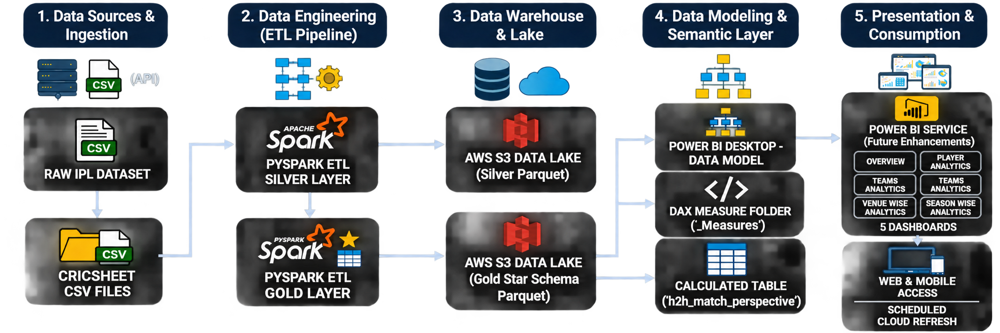
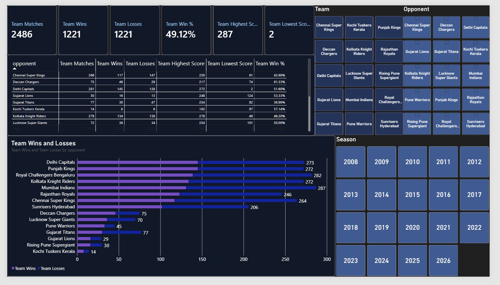

# IPL Historical Analytics

<p align="center">
  
</p>
An end-to-end business intelligence solution for exploring historical Indian Premier League (IPL) performance. The project turns ball-by-ball match data into governed analytics tables, publishes them to an AWS S3 data lake and PostgreSQL, and presents the results in an interactive Power BI report.

## Highlights

- **Medallion-style data pipeline** — raw CSV extracts progress through Bronze, Silver, and Gold layers.
- **Analytics-ready model** — eight Gold dimension and fact tables support match, player, team, and venue analysis.
- **Data-quality transformations** — standardises historical franchise and venue names, normalises season values, and applies cricket-aware metric logic.
- **Cloud-ready delivery** — synchronises lake layers to Amazon S3 and loads curated tables into PostgreSQL.
- **Interactive reporting** — a five-page Power BI report supports overview, player, team, venue, and season analysis.

## Architecture

<p align="center">
  
</p>

```text
Cricsheet ball-by-ball CSVs
          │
          ▼
Bronze  ─── Raw source extracts
          │  etl_silver.py
          ▼
Silver  ─── Cleaned, standardised delivery-level Parquet (partitioned by season)
          │  etl_gold.py
          ▼
Gold    ─── Curated dimensions and facts in Parquet
          ├──────────────────────────► Amazon S3 data lake
          │                              upload_to_s3.py
          └──────────────────────────► PostgreSQL
                                                    │
                                                    ▼
                                             Power BI dashboard
```

### S3 data lake

The S3 lake preserves the three data layers, with raw Bronze data stored as a compressed archive and curated Silver/Gold datasets stored as Parquet objects.

<p align="center">
  
</p>

## Repository structure

```text
├── data-engineering/
│   ├── etl_silver.py          # Cleans and standardises delivery-level data
│   ├── etl_gold.py            # Builds curated analytical tables
│   ├── upload_to_s3.py        # Publishes Bronze, Silver, and Gold layers to S3
├── docs/images/               # Architecture and dashboard screenshots
├── powerbi/ipl-bi.pbix        # Power BI report
├── .env.example               # Required environment variables template
└── requirements.txt           # Python dependencies
```

## Data model

The Gold layer contains eight analytics-ready tables.

| Category | Tables | Grain / purpose |
| --- | --- | --- |
| Dimensions | `dim_seasons`, `dim_teams`, `dim_venues`, `dim_players` | Reference entities for slicing and filtering. |
| Match facts | `fact_matches` | One record per match, including teams, innings totals, winner, and margin. |
| Player facts | `fact_player_batting_season`, `fact_player_bowling_season` | One record per player, season, and team. |
| Venue facts | `fact_venue_stats` | One record per venue with scoring and outcome metrics. |

Key business rules include canonical franchise mappings (for example, Delhi Daredevils to Delhi Capitals), venue-name standardisation, season normalisation, and the exclusion of Super Overs from standard innings totals.

## Power BI semantic model

Power BI ingests each Gold dataset with the **Folder** connector. For every Gold table folder, filter to `Extension = ".parquet"`, combine the files, validate numeric data types, and load the query using the Gold table name. This avoids loading Spark control files such as `_SUCCESS` and `.crc`.

The semantic model uses one-to-many relationships from the dimension tables to the facts. A dedicated `_Measures` table keeps calculation logic separate from the imported data tables. The calculated `h2h_match_perspective` table presents one row from each team's perspective and is linked to `dim_seasons[season]`; it powers team and head-to-head analysis.

Use a synced Season slicer across report pages. Player views use bookmarks to switch between batting, bowling, and consistency perspectives. Set score and count visuals to **Display units: None** so exact cricket scores remain visible, and configure edit interactions so detailed tables do not unintentionally collapse during cross-filtering.

### DAX measure catalogue

All measures below belong in the `_Measures` table.

<details>
<summary><strong>Overview and match outcomes</strong></summary>

```dax
Total Seasons = DISTINCTCOUNT(dim_seasons[season])

Total Matches = COUNTROWS(fact_matches)

Total Players = DISTINCTCOUNT(dim_players[player_name])

Total Venues = DISTINCTCOUNT(dim_venues[venue_name])

Avg 1st Innings Score = ROUND(AVERAGE(fact_matches[innings_1_runs]), 2)

Avg 2nd Innings Score = ROUND(AVERAGE(fact_matches[innings_2_runs]), 2)

Highest Team Score =
MAXX(
    fact_matches,
    MAX(fact_matches[innings_1_runs], fact_matches[innings_2_runs])
)

Chase Wins =
CALCULATE(COUNTROWS(fact_matches), fact_matches[win_type] = "wickets")

Bat First Wins =
CALCULATE(COUNTROWS(fact_matches), fact_matches[win_type] = "runs")

Chase Win Rate =
VAR DecidedMatches =
    CALCULATE(
        COUNTROWS(fact_matches),
        fact_matches[win_type] IN {"runs", "wickets"}
    )
RETURN
DIVIDE([Chase Wins], DecidedMatches, 0)

Modern Era Shift Runs =
VAR EarlyAvg =
    CALCULATE(
        AVERAGE(fact_matches[innings_1_runs]),
        dim_seasons[season] <= 2017,
        NOT ISBLANK(fact_matches[innings_1_runs])
    )
VAR ModernAvg =
    CALCULATE(
        AVERAGE(fact_matches[innings_1_runs]),
        dim_seasons[season] >= 2018,
        NOT ISBLANK(fact_matches[innings_1_runs])
    )
RETURN
ROUND(ModernAvg - EarlyAvg, 2)
```

</details>

<details>
<summary><strong>Batting, bowling, boundaries, and consistency</strong></summary>

```dax
Total Runs = SUM(fact_player_batting_season[runs])

Total Balls Faced = SUM(fact_player_batting_season[balls_faced])

Total Dismissals = SUM(fact_player_batting_season[dismissals])

Total Fours = SUM(fact_player_batting_season[fours])

Total Sixes = SUM(fact_player_batting_season[sixes])

Boundary Runs = ([Total Fours] * 4) + ([Total Sixes] * 6)

Running Runs = [Total Runs] - [Boundary Runs]

Career Batting Avg =
DIVIDE([Total Runs], [Total Dismissals], BLANK())

Career Batting SR =
DIVIDE([Total Runs] * 100, [Total Balls Faced], BLANK())

Total Wickets = SUM(fact_player_bowling_season[wickets])

Total Legal Balls = SUM(fact_player_bowling_season[legal_balls])

Total Runs Conceded = SUM(fact_player_bowling_season[runs_conceded])

Career Bowling Economy =
DIVIDE([Total Runs Conceded] * 6, [Total Legal Balls], BLANK())

Career Bowling SR =
DIVIDE([Total Legal Balls], [Total Wickets], BLANK())

Season Runs CV =
VAR PlayerSeasons =
    FILTER(
        SUMMARIZE(
            fact_player_batting_season,
            dim_players[player_name],
            dim_seasons[season],
            "SeasonRuns", SUM(fact_player_batting_season[runs])
        ),
        NOT ISBLANK([SeasonRuns])
    )
VAR MeanRuns = AVERAGEX(PlayerSeasons, [SeasonRuns])
VAR StdRuns = STDEVX.S(PlayerSeasons, [SeasonRuns])
VAR SeasonCount = COUNTROWS(PlayerSeasons)
RETURN
IF(
    SeasonCount >= 3 && MeanRuns > 0,
    ROUND(DIVIDE(StdRuns, MeanRuns), 3),
    BLANK()
)

Top Batter Runs =
MAXX(
    VALUES(dim_players[player_name]),
    CALCULATE(SUM(fact_player_batting_season[runs]))
)

Top Batter Name =
FIRSTNONBLANK(
    TOPN(
        1,
        VALUES(dim_players[player_name]),
        CALCULATE(SUM(fact_player_batting_season[runs])),
        DESC
    ),
    1
)

Top Bowler Wickets =
MAXX(
    VALUES(dim_players[player_name]),
    CALCULATE(SUM(fact_player_bowling_season[wickets]))
)

Top Bowler Name =
FIRSTNONBLANK(
    TOPN(
        1,
        VALUES(dim_players[player_name]),
        CALCULATE(SUM(fact_player_bowling_season[wickets])),
        DESC
    ),
    1
)
```

</details>

<details>
<summary><strong>Team and head-to-head measures</strong></summary>

```dax
Team Matches = COUNTROWS(h2h_match_perspective)

Team Wins = SUM(h2h_match_perspective[won])

Team Losses =
CALCULATE(
    COUNTROWS(h2h_match_perspective),
    h2h_match_perspective[won] = 0,
    h2h_match_perspective[win_type] IN {"runs", "wickets"}
)

Team Win % = DIVIDE([Team Wins], [Team Matches], 0)

Team Highest Score = MAX(h2h_match_perspective[team_score])

Team Lowest Score = MIN(h2h_match_perspective[team_score])
```

</details>

<details>
<summary><strong>Venue measures</strong></summary>

```dax
Active Venues = DISTINCTCOUNT(fact_matches[venue])

Venue Matches = COUNTROWS(fact_matches)

Venue Avg 1st Innings =
ROUND(
    CALCULATE(
        AVERAGE(fact_matches[innings_1_runs]),
        NOT ISBLANK(fact_matches[innings_1_runs])
    ),
    2
)

Venue Highest Score =
CALCULATE(
    MAX(fact_matches[innings_1_runs]),
    NOT ISBLANK(fact_matches[innings_1_runs])
)

Venue Lowest Score =
CALCULATE(
    MIN(fact_matches[innings_1_runs]),
    NOT ISBLANK(fact_matches[innings_1_runs])
)

Venue Bat First Wins =
CALCULATE(
    COUNTROWS(fact_matches),
    fact_matches[win_type] = "runs"
)

Venue Chase Wins =
CALCULATE(
    COUNTROWS(fact_matches),
    fact_matches[win_type] = "wickets"
)

Venue Chase Win % =
VAR Decided = [Venue Bat First Wins] + [Venue Chase Wins]
RETURN
DIVIDE([Venue Chase Wins], Decided, 0)
```

</details>

## Dashboard

The Power BI report is available at [`powerbi/ipl-bi.pbix`](powerbi/ipl-bi.pbix). Its broadcast-dark design uses a `#0B1120` canvas, `#111827` cards, `#1E293B` borders, amber highlights (`#F59E0B`), sky-blue accents (`#38BDF8`), and emerald success states (`#10B981`).

| View | Purpose |
| --- | --- |
| Overview | Track IPL-wide KPIs, scoring trends, leading teams, and seasonal performance. |
| Player Analytics | Compare batting and bowling contributions across seasons and teams. |
| Teams Analytics | Analyse head-to-head records, score extremes, and match-by-match team outcomes. |
| Venue-wise Analytics | Explore stadium scoring patterns, match volumes, and chasing outcomes. |
| Season-wise Analytics | Examine year-over-year trends, champions, and the shift between IPL eras. |

<p align="center">
  
</p>
<p align="center">
  
  
</p>
<p align="center">
  
</p>

## End-to-end delivery workflow

```text
Raw IPL match, ball-by-ball, and player data
                 │
                 ▼
PySpark ETL — Bronze → Silver → Gold Parquet
                 │
                 ├── dim_seasons                 ├── fact_matches
                 ├── dim_teams                   ├── fact_player_batting_season
                 ├── dim_venues                  ├── fact_player_bowling_season
                 └── dim_players                 └── fact_venue_stats
                 │
                 ▼
Power BI Folder connector → eight imported tables
                 │
                 ▼
Star schema + h2h_match_perspective + _Measures
                 │
                 ▼
Five interactive dashboard pages
                 │
                 ▼
Git and GitHub version control
```

### Delivery checklist

1. **Build and validate Gold.** Run the Silver and Gold PySpark jobs, then confirm all eight Gold dataset folders contain Parquet part files.
2. **Ingest with Power Query.** Create one Folder query per Gold folder; filter to `.parquet`, combine files, validate types, name the query after the Gold table, and select **Close & Apply**.
3. **Model the data.** Confirm one-to-many dimension-to-fact relationships in Model view. Create `_Measures` and `h2h_match_perspective`, including its Season relationship.
4. **Apply the report system.** Apply the Know IPL Broadcast Dark theme, synced Season slicers, bookmarks on Player Analytics, and intentional visual interactions.
5. **Validate pages.** Check Overview, Player Analytics, Teams Analytics, Venue-wise Analytics, and Season-wise Analytics against the selected filters and measure definitions.
6. **Version the work.** Make focused Git commits after data-model, measure, and dashboard milestones; push validated increments to GitHub.

## Getting started

### Prerequisites

- Python 3.10 or later
- Java runtime compatible with PySpark
- An AWS account and S3 bucket (for lake synchronisation)
- A PostgreSQL database (for relational serving)
- Power BI Desktop (to open and refresh the report)

### 1. Set up the environment

```powershell
python -m venv .venv
.\.venv\Scripts\Activate.ps1
pip install -r requirements.txt
Copy-Item .env.example .env
```

Update `.env` with your PostgreSQL connection string and AWS credentials. Never commit this file.

### 2. Add source data

Place the raw, ball-by-ball Cricsheet CSV files in:

```text
data-engineering/bronze/cricsheet_raw/
```

Only numeric match CSV filenames are processed; metadata and aggregate CSVs are intentionally ignored by the Silver ETL.

### 3. Build the lakehouse layers

Run the scripts from the repository root, in order:

```powershell
python data-engineering/etl_silver.py
python data-engineering/etl_gold.py
```

This produces season-partitioned Silver deliveries and the eight Gold tables under `data-engineering/`.

### 4. Publish curated data

Synchronise the local lakehouse to S3:

```powershell
python data-engineering/upload_to_s3.py
```

Bronze is uploaded as `bronze/cricsheet_raw.zip`; Silver and Gold prefixes are refreshed to prevent stale Parquet objects from accumulating. To explicitly re-upload Bronze, run:

```powershell
python data-engineering/upload_to_s3.py --force-bronze
```

Load the Gold tables into PostgreSQL with your chosen loader. The target tables must already exist, and the loader should reload the eight analytics tables in dependency order using a dedicated analytics schema/database connection.

### 5. Explore the report

Open [`powerbi/ipl-bi.pbix`](powerbi/ipl-bi.pbix) in Power BI Desktop. Configure or refresh its data source as appropriate for your PostgreSQL deployment.

## Configuration

Use [`.env.example`](.env.example) as the configuration template.

| Variable | Description |
| --- | --- |
| `AWS_ACCESS_KEY_ID` | IAM access key permitted to access the S3 bucket. |
| `AWS_SECRET_ACCESS_KEY` | IAM secret access key. |
| `AWS_REGION` | AWS region for the bucket; defaults to `ap-south-1`. |
| `AWS_S3_BUCKET` | Destination bucket for the data lake. |

## Operational notes

- Each ETL and publishing script writes a run log to `data-engineering/logs/`.
- Generated data, logs, archives, credentials, and local environments are excluded from version control.
- The PostgreSQL loader uses an idempotent truncate-and-reload pattern, preserving the existing table definitions and relationships.

## Technology stack

Python · PySpark · Pandas · PyArrow · Amazon S3 · Power BI
