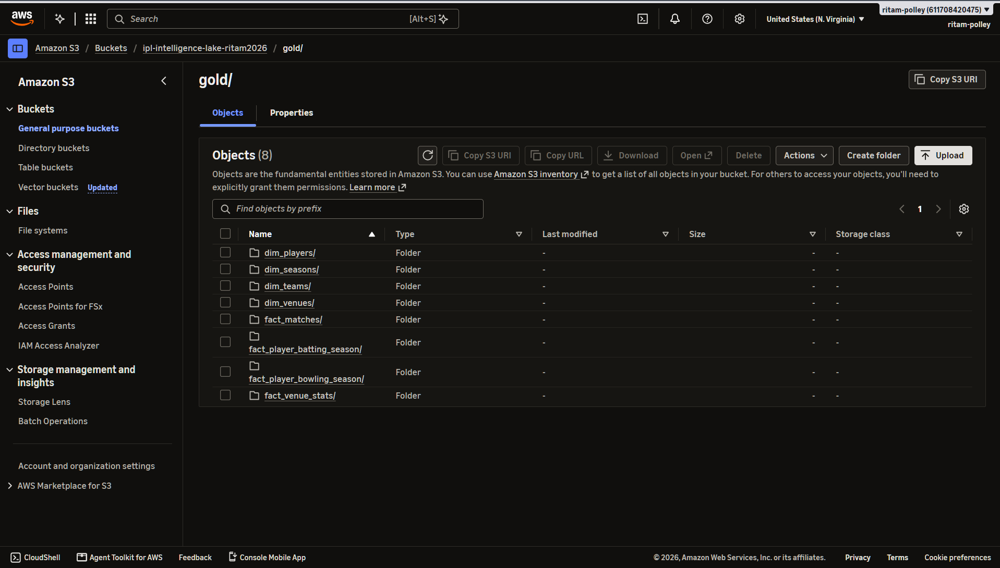
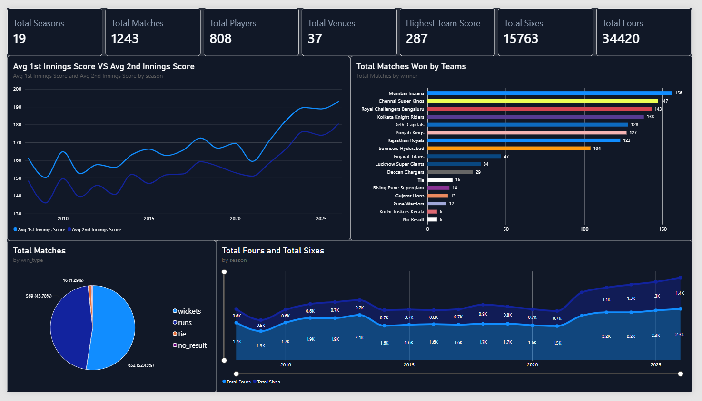
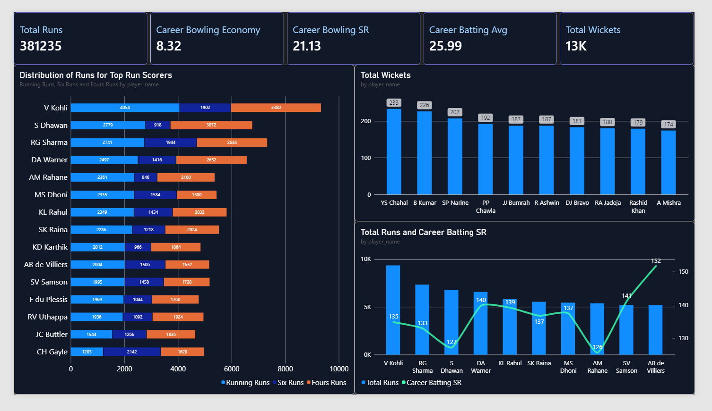
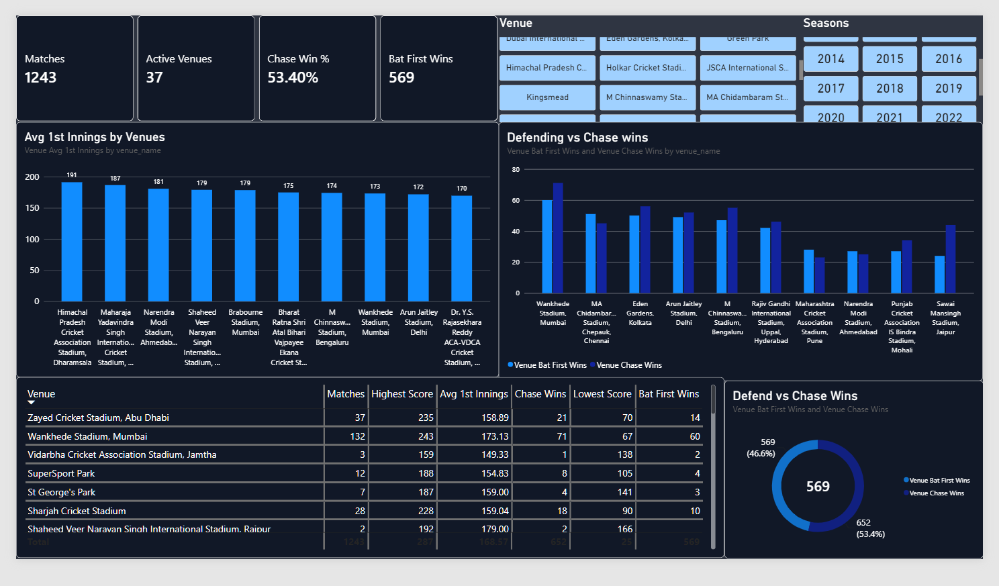

# IPL Historical Analytics

<p align="center">
  
</p>
An end-to-end business intelligence solution for exploring historical Indian Premier League (IPL) performance. The project turns ball-by-ball match data into governed analytics tables, publishes them to an AWS S3 data lake and PostgreSQL, and presents the results in an interactive Power BI report.

## Highlights

- **Medallion-style data pipeline** — raw CSV extracts progress through Bronze, Silver, and Gold layers.
- **Analytics-ready model** — eight Gold dimension and fact tables support match, player, team, and venue analysis.
- **Data-quality transformations** — standardises historical franchise and venue names, normalises season values, and applies cricket-aware metric logic.
- **Cloud-ready delivery** — synchronises lake layers to Amazon S3 and loads curated tables into PostgreSQL.
- **Interactive reporting** — the documented report views cover overview, player, venue, and team head-to-head analysis.

## Architecture

<p align="center">
  
</p>

```text
Cricsheet ball-by-ball CSVs
          │
          ▼
Bronze  ─── Raw source extracts
          │  etl_silver.py
          ▼
Silver  ─── Cleaned, standardised delivery-level Parquet (partitioned by season)
          │  etl_gold.py
          ▼
Gold    ─── Curated dimensions and facts in Parquet
          ├──────────────────────────► Amazon S3 data lake
          │                              upload_to_s3.py
          └──────────────────────────► PostgreSQL
                                                    │
                                                    ▼
                                             Power BI dashboard
```

### S3 data lake

The S3 lake preserves the three data layers, with raw Bronze data stored as a compressed archive and curated Silver/Gold datasets stored as Parquet objects.

<p align="center">
  
</p>

## Repository structure

```text
├── data-engineering/
│   ├── etl_silver.py          # Cleans and standardises delivery-level data
│   ├── etl_gold.py            # Builds curated analytical tables
│   ├── upload_to_s3.py        # Publishes Bronze, Silver, and Gold layers to S3
├── docs/images/               # Architecture and dashboard screenshots
├── powerbi/ipl-bi.pbix        # Power BI report
├── .env.example               # Required environment variables template
└── requirements.txt           # Python dependencies
```

## Data model

The Gold layer contains eight analytics-ready tables.

| Category | Tables | Grain / purpose |
| --- | --- | --- |
| Dimensions | `dim_seasons`, `dim_teams`, `dim_venues`, `dim_players` | Reference entities for slicing and filtering. |
| Match facts | `fact_matches` | One record per match, including teams, innings totals, winner, and margin. |
| Player facts | `fact_player_batting_season`, `fact_player_bowling_season` | One record per player, season, and team. |
| Venue facts | `fact_venue_stats` | One record per venue with scoring and outcome metrics. |

Key business rules include canonical franchise mappings (for example, Delhi Daredevils to Delhi Capitals), venue-name standardisation, season normalisation, and the exclusion of Super Overs from standard innings totals.

## Power BI semantic model

Power BI ingests each Gold dataset with the **Folder** connector. For every Gold table folder, filter to `Extension = ".parquet"`, combine the files, validate numeric data types, and load the query using the Gold table name. This avoids loading Spark control files such as `_SUCCESS` and `.crc`.

The semantic model uses one-to-many relationships from the dimension tables to the facts. A dedicated `_Measures` table keeps calculation logic separate from the imported data tables. The calculated `h2h_match_perspective` table presents one row from each team's perspective and is linked to `dim_seasons[season]`; it powers team and head-to-head analysis.

Use a synced Season slicer across report pages. Player views use bookmarks to switch between batting, bowling, and consistency perspectives. Set score and count visuals to **Display units: None** so exact cricket scores remain visible, and configure edit interactions so detailed tables do not unintentionally collapse during cross-filtering.

### DAX measure catalogue

All measures below belong in the `_Measures` table.

<details>
<summary><strong>Overview and match outcomes</strong></summary>

```dax
Total Seasons = DISTINCTCOUNT(dim_seasons[season])

Total Matches = COUNTROWS(fact_matches)

Total Players = DISTINCTCOUNT(dim_players[player_name])

Total Venues = DISTINCTCOUNT(dim_venues[venue_name])

Avg 1st Innings Score = ROUND(AVERAGE(fact_matches[innings_1_runs]), 2)

Avg 2nd Innings Score = ROUND(AVERAGE(fact_matches[innings_2_runs]), 2)

Highest Team Score =
MAXX(
    fact_matches,
    MAX(fact_matches[innings_1_runs], fact_matches[innings_2_runs])
)

Chase Wins =
CALCULATE(COUNTROWS(fact_matches), fact_matches[win_type] = "wickets")

Bat First Wins =
CALCULATE(COUNTROWS(fact_matches), fact_matches[win_type] = "runs")

Chase Win Rate =
VAR DecidedMatches =
    CALCULATE(
        COUNTROWS(fact_matches),
        fact_matches[win_type] IN {"runs", "wickets"}
    )
RETURN
DIVIDE([Chase Wins], DecidedMatches, 0)

Modern Era Shift Runs =
VAR EarlyAvg =
    CALCULATE(
        AVERAGE(fact_matches[innings_1_runs]),
        dim_seasons[season] <= 2017,
        NOT ISBLANK(fact_matches[innings_1_runs])
    )
VAR ModernAvg =
    CALCULATE(
        AVERAGE(fact_matches[innings_1_runs]),
        dim_seasons[season] >= 2018,
        NOT ISBLANK(fact_matches[innings_1_runs])
    )
RETURN
ROUND(ModernAvg - EarlyAvg, 2)
```

</details>

<details>
<summary><strong>Batting, bowling, boundaries, and consistency</strong></summary>

```dax
Total Runs = SUM(fact_player_batting_season[runs])

Total Balls Faced = SUM(fact_player_batting_season[balls_faced])

Total Dismissals = SUM(fact_player_batting_season[dismissals])

Total Fours = SUM(fact_player_batting_season[fours])

Total Sixes = SUM(fact_player_batting_season[sixes])

Boundary Runs = ([Total Fours] * 4) + ([Total Sixes] * 6)

Running Runs = [Total Runs] - [Boundary Runs]

Career Batting Avg =
DIVIDE([Total Runs], [Total Dismissals], BLANK())

Career Batting SR =
DIVIDE([Total Runs] * 100, [Total Balls Faced], BLANK())

Total Wickets = SUM(fact_player_bowling_season[wickets])

Total Legal Balls = SUM(fact_player_bowling_season[legal_balls])

Total Runs Conceded = SUM(fact_player_bowling_season[runs_conceded])

Career Bowling Economy =
DIVIDE([Total Runs Conceded] * 6, [Total Legal Balls], BLANK())

Career Bowling SR =
DIVIDE([Total Legal Balls], [Total Wickets], BLANK())

Season Runs CV =
VAR PlayerSeasons =
    FILTER(
        SUMMARIZE(
            fact_player_batting_season,
            dim_players[player_name],
            dim_seasons[season],
            "SeasonRuns", SUM(fact_player_batting_season[runs])
        ),
        NOT ISBLANK([SeasonRuns])
    )
VAR MeanRuns = AVERAGEX(PlayerSeasons, [SeasonRuns])
VAR StdRuns = STDEVX.S(PlayerSeasons, [SeasonRuns])
VAR SeasonCount = COUNTROWS(PlayerSeasons)
RETURN
IF(
    SeasonCount >= 3 && MeanRuns > 0,
    ROUND(DIVIDE(StdRuns, MeanRuns), 3),
    BLANK()
)

Top Batter Runs =
MAXX(
    VALUES(dim_players[player_name]),
    CALCULATE(SUM(fact_player_batting_season[runs]))
)

Top Batter Name =
FIRSTNONBLANK(
    TOPN(
        1,
        VALUES(dim_players[player_name]),
        CALCULATE(SUM(fact_player_batting_season[runs])),
        DESC
    ),
    1
)

Top Bowler Wickets =
MAXX(
    VALUES(dim_players[player_name]),
    CALCULATE(SUM(fact_player_bowling_season[wickets]))
)

Top Bowler Name =
FIRSTNONBLANK(
    TOPN(
        1,
        VALUES(dim_players[player_name]),
        CALCULATE(SUM(fact_player_bowling_season[wickets])),
        DESC
    ),
    1
)
```

</details>

<details>
<summary><strong>Team and head-to-head measures</strong></summary>

```dax
Team Matches = COUNTROWS(h2h_match_perspective)

Team Wins = SUM(h2h_match_perspective[won])

Team Losses =
CALCULATE(
    COUNTROWS(h2h_match_perspective),
    h2h_match_perspective[won] = 0,
    h2h_match_perspective[win_type] IN {"runs", "wickets"}
)

Team Win % = DIVIDE([Team Wins], [Team Matches], 0)

Team Highest Score = MAX(h2h_match_perspective[team_score])

Team Lowest Score = MIN(h2h_match_perspective[team_score])
```

</details>

<details>
<summary><strong>Venue measures</strong></summary>

```dax
Active Venues = DISTINCTCOUNT(fact_matches[venue])

Venue Matches = COUNTROWS(fact_matches)

Venue Avg 1st Innings =
ROUND(
    CALCULATE(
        AVERAGE(fact_matches[innings_1_runs]),
        NOT ISBLANK(fact_matches[innings_1_runs])
    ),
    2
)

Venue Highest Score =
CALCULATE(
    MAX(fact_matches[innings_1_runs]),
    NOT ISBLANK(fact_matches[innings_1_runs])
)

Venue Lowest Score =
CALCULATE(
    MIN(fact_matches[innings_1_runs]),
    NOT ISBLANK(fact_matches[innings_1_runs])
)

Venue Bat First Wins =
CALCULATE(
    COUNTROWS(fact_matches),
    fact_matches[win_type] = "runs"
)

Venue Chase Wins =
CALCULATE(
    COUNTROWS(fact_matches),
    fact_matches[win_type] = "wickets"
)

Venue Chase Win % =
VAR Decided = [Venue Bat First Wins] + [Venue Chase Wins]
RETURN
DIVIDE([Venue Chase Wins], Decided, 0)
```

</details>

### Measure and table design

Raw IPL fields are useful for individual match or player records, but the report needs reusable calculations that respond correctly to slicers. The `_Measures` table is therefore a dedicated home for DAX logic: it keeps calculations out of the fact tables, gives every visual one consistent definition, and avoids incorrect aggregation of rates such as strike rate, economy, and win percentage.

#### Model tables

| Table | Why it exists | Used for |
| --- | --- | --- |
| `dim_seasons` | Provides one canonical row per season. | Season slicers and year-by-year charts. |
| `dim_teams` | Provides canonical franchise names, including historically standardised names. | Team and opponent filtering. |
| `dim_venues` | Provides a controlled venue list. | Venue filtering and venue-level reporting. |
| `dim_players` | Provides one row per player. | Player labels, ranking, and filtering. |
| `fact_matches` | Stores one record per match, including innings totals, winner, venue, and win type. | Overview and venue KPIs, score trends, win-type analysis, and venue outcomes. |
| `fact_player_batting_season` | Stores one player-season-team batting record. | Runs, balls faced, dismissals, boundaries, batting average, strike rate, and consistency calculations. |
| `fact_player_bowling_season` | Stores one player-season-team bowling record. | Wickets, legal balls, conceded runs, economy, and bowling strike rate. |
| `fact_venue_stats` | Stores venue-level scoring and outcome statistics. | A curated venue summary for validation or further venue analysis. The shown venue measures calculate from `fact_matches` so they follow the active filters. |
| `h2h_match_perspective` | Expands each match into one row for each competing team, with the other team recorded as its opponent. | Lets one set of team measures work for a selected franchise and every opponent; otherwise teams stored in separate `team_1` and `team_2` columns would require separate logic. |
| `_Measures` | Holds DAX measures rather than imported rows. | Centralised, reusable report calculations. |

#### Why each measure exists

| Measure group | Measures | Purpose |
| --- | --- | --- |
| Report scale and scoring | `Total Seasons`, `Total Matches`, `Total Players`, `Total Venues`, `Avg 1st Innings Score`, `Avg 2nd Innings Score`, `Highest Team Score` | Establish the size of the data and the baseline or maximum scoring environment. The average and maximum calculations must be evaluated in the current filter context. |
| Match outcomes | `Chase Wins`, `Bat First Wins`, `Chase Win Rate` | Separates matches won while chasing from matches won by defending. `Chase Win Rate` divides only by decided matches, so ties and no-results do not distort the percentage. |
| Era comparison | `Modern Era Shift Runs` | Calculates the difference between average first-innings score through 2017 and from 2018 onward. It provides a single number for an era-scoring comparison; it is defined in the model but is not displayed in the supplied screenshots. |
| Batting totals and boundary split | `Total Runs`, `Total Balls Faced`, `Total Dismissals`, `Total Fours`, `Total Sixes`, `Boundary Runs`, `Running Runs` | Supplies batting volume and decomposes scoring into runs from fours, sixes, and all other running/non-boundary runs. `Boundary Runs` and `Running Runs` cannot be obtained by simply summing a pre-calculated ratio. |
| Batting rates | `Career Batting Avg`, `Career Batting SR` | Calculates runs per dismissal and runs per 100 balls from filtered totals. Recalculating from totals prevents inaccurate averages when several seasons or players are selected. |
| Bowling totals and rates | `Total Wickets`, `Total Legal Balls`, `Total Runs Conceded`, `Career Bowling Economy`, `Career Bowling SR` | Converts bowling events into cricket-standard rates: runs conceded per six legal balls and legal balls per wicket. Legal balls are used so wides and no-balls do not incorrectly inflate the denominator. |
| Batting consistency and leaders | `Season Runs CV`, `Top Batter Runs`, `Top Batter Name`, `Top Bowler Wickets`, `Top Bowler Name` | `Season Runs CV` compares a player's season-to-season variation with their mean output and returns a result only after at least three seasons. The leader measures return the highest filtered batting or bowling total and the corresponding player name. These measures are defined for analysis but no consistency or leader card is visible in the supplied screenshots. |
| Team head-to-head | `Team Matches`, `Team Wins`, `Team Losses`, `Team Win %`, `Team Highest Score`, `Team Lowest Score` | Uses `h2h_match_perspective` so a team can be evaluated uniformly against all opponents. Losses count only decided matches; win percentage is calculated from the filtered team-match count; score measures identify a team's extremes. |
| Venue | `Active Venues`, `Venue Matches`, `Venue Avg 1st Innings`, `Venue Highest Score`, `Venue Lowest Score`, `Venue Bat First Wins`, `Venue Chase Wins`, `Venue Chase Win %` | Provides a filter-aware stadium profile. The chase rate uses decided venue matches only, while the other measures quantify venue sample size, scoring level/extremes, and defending-versus-chasing outcomes. |

### Dashboard guide

The screenshots document four dashboard views. Values in every visual are intended to change with the available slicers and cross-filtering.

#### Overview

| Element | Measures or fields | What it answers |
| --- | --- | --- |
| KPI strip | `Total Seasons`, `Total Matches`, `Total Players`, `Total Venues`, `Highest Team Score`, plus total fours and sixes | Gives a top-level view of the report’s time span, match/player/venue coverage, highest innings total, and aggregate boundary volume. |
| **Avg 1st Innings Score VS Avg 2nd Innings Score** line chart | `Avg 1st Innings Score`, `Avg 2nd Innings Score`, season | Shows how scoring in each innings has changed by season. |
| **Total Matches Won by Teams** bar chart | Match count, winner/team | Ranks franchises by number of wins. |
| **Total Matches** pie chart | Match count by `win_type` | Shows the split of wicket wins, run wins, ties, and no-results. |
| **Total Fours and Total Sixes** seasonal chart | Total fours, total sixes, season | Shows whether boundary volume has changed over the tournament’s history. |

#### Player Analytics

| Element | Measures | What it answers |
| --- | --- | --- |
| KPI strip | `Total Runs`, `Career Bowling Economy`, `Career Bowling SR`, `Career Batting Avg`, `Total Wickets` | Gives a compact view of batting output and bowling effectiveness in the current filter context. |
| **Distribution of Runs for Top Run Scorers** stacked bars | `Running Runs`, six runs, fours runs | Breaks each leading batter’s runs into non-boundary runs, sixes, and fours, making scoring style comparable. |
| **Total Wickets** bar chart | `Total Wickets` by player | Ranks wicket-taking volume. |
| **Total Runs and Career Batting SR** combo chart | `Total Runs`, `Career Batting SR` by player | Pairs scoring volume with scoring speed so a high run total is not viewed without its strike rate. |

#### Venue-wise Analytics

| Element | Measures or fields | What it answers |
| --- | --- | --- |
| KPI strip | `Venue Matches`, `Active Venues`, `Venue Chase Win %`, `Venue Bat First Wins` | Summarises the active venue selection, its sample size, and broad chasing/defending outcomes. |
| Venue and Season slicers | Venue and season | Let viewers focus every venue calculation on selected grounds and seasons. |
| **Avg 1st Innings by Venues** bar chart | `Venue Avg 1st Innings` by venue | Ranks grounds by typical first-innings score. |
| **Defending vs Chase wins** clustered bars | `Venue Bat First Wins`, `Venue Chase Wins` by venue | Compares whether teams have won more often while defending or chasing at each ground. |
| Venue profile table | Venue, `Venue Matches`, `Venue Highest Score`, `Venue Avg 1st Innings`, `Venue Chase Wins`, `Venue Lowest Score`, `Venue Bat First Wins` | Gives a detailed, sortable venue comparison behind the charts. |
| **Defend vs Chase Wins** donut | `Venue Bat First Wins`, `Venue Chase Wins` | Shows the overall defending-versus-chasing split for the active selection. |

#### Team Head-to-Head Analytics

| Element | Measures or fields | What it answers |
| --- | --- | --- |
| KPI strip | `Team Matches`, `Team Wins`, `Team Losses`, `Team Win %`, `Team Highest Score`, `Team Lowest Score` | Summarises the selected team’s record and scoring extremes. |
| Team, Opponent, and Season slicers | Team, opponent, season | Define the franchise, rival, and time period used by all head-to-head measures. |
| Opponent table | Opponent with all team head-to-head measures | Identifies opponents against whom the selected team has played most, won/lost most, or recorded score extremes. |
| **Team Wins and Losses** stacked bars | `Team Wins`, `Team Losses` by opponent | Makes the head-to-head balance against every opponent visually comparable. |

## Dashboard

The Power BI report is available at [`powerbi/ipl-bi.pbix`](powerbi/ipl-bi.pbix). Its broadcast-dark design uses a `#0B1120` canvas, `#111827` cards, `#1E293B` borders, amber highlights (`#F59E0B`), sky-blue accents (`#38BDF8`), and emerald success states (`#10B981`).

| View | Screenshot-verified contents |
| --- | --- |
| Overview | KPI cards for total seasons, matches, players, venues, highest team score, sixes, and fours; seasonal first- versus second-innings scoring; matches won by team; win-type split; and fours/sixes by season. |
| Player Analytics | KPI cards for total runs, bowling economy and strike rate, batting average, and wickets; run-composition bars for leading scorers; leading wicket-takers; and a total-runs versus batting-strike-rate combo chart. |
| Venue-wise Analytics | Match, active-venue, chase-win-rate, and bat-first-win KPIs; venue and season slicers; first-innings scoring by venue; defend-versus-chase comparisons; a venue profile table; and a defend-versus-chase donut. |
| Team Head-to-Head Analytics | Team, opponent, and season slicers; team record and score-extremes KPIs; an opponent-level head-to-head table; and team wins versus losses by opponent. |

<p align="center">
  
</p>
<p align="center">
  
  
</p>
<p align="center">
  
</p>

## End-to-end delivery workflow

```text
Raw IPL match, ball-by-ball, and player data
                 │
                 ▼
PySpark ETL — Bronze → Silver → Gold Parquet
                 │
                 ├── dim_seasons                 ├── fact_matches
                 ├── dim_teams                   ├── fact_player_batting_season
                 ├── dim_venues                  ├── fact_player_bowling_season
                 └── dim_players                 └── fact_venue_stats
                 │
                 ▼
Power BI Folder connector → eight imported tables
                 │
                 ▼
Star schema + h2h_match_perspective + _Measures
                 │
                 ▼
Documented dashboard views
                 │
                 ▼
Git and GitHub version control
```

### Delivery checklist

1. **Build and validate Gold.** Run the Silver and Gold PySpark jobs, then confirm all eight Gold dataset folders contain Parquet part files.
2. **Ingest with Power Query.** Create one Folder query per Gold folder; filter to `.parquet`, combine files, validate types, name the query after the Gold table, and select **Close & Apply**.
3. **Model the data.** Confirm one-to-many dimension-to-fact relationships in Model view. Create `_Measures` and `h2h_match_perspective`, including its Season relationship.
4. **Apply the report system.** Apply the Know IPL Broadcast Dark theme, synced Season slicers, bookmarks on Player Analytics, and intentional visual interactions.
5. **Validate pages.** Check the documented Overview, Player Analytics, Venue-wise Analytics, and Team Head-to-Head views against the selected filters and measure definitions.
6. **Version the work.** Make focused Git commits after data-model, measure, and dashboard milestones; push validated increments to GitHub.

## Getting started

### Prerequisites

- Python 3.10 or later
- Java runtime compatible with PySpark
- An AWS account and S3 bucket (for lake synchronisation)
- A PostgreSQL database (for relational serving)
- Power BI Desktop (to open and refresh the report)

### 1. Set up the environment

```powershell
python -m venv .venv
.\.venv\Scripts\Activate.ps1
pip install -r requirements.txt
Copy-Item .env.example .env
```

Update `.env` with your PostgreSQL connection string and AWS credentials. Never commit this file.

### 2. Add source data

Place the raw, ball-by-ball Cricsheet CSV files in:

```text
data-engineering/bronze/cricsheet_raw/
```

Only numeric match CSV filenames are processed; metadata and aggregate CSVs are intentionally ignored by the Silver ETL.

### 3. Build the lakehouse layers

Run the scripts from the repository root, in order:

```powershell
python data-engineering/etl_silver.py
python data-engineering/etl_gold.py
```

This produces season-partitioned Silver deliveries and the eight Gold tables under `data-engineering/`.

### 4. Publish curated data

Synchronise the local lakehouse to S3:

```powershell
python data-engineering/upload_to_s3.py
```

Bronze is uploaded as `bronze/cricsheet_raw.zip`; Silver and Gold prefixes are refreshed to prevent stale Parquet objects from accumulating. To explicitly re-upload Bronze, run:

```powershell
python data-engineering/upload_to_s3.py --force-bronze
```

Load the Gold tables into PostgreSQL with your chosen loader. The target tables must already exist, and the loader should reload the eight analytics tables in dependency order using a dedicated analytics schema/database connection.

### 5. Explore the report

Open [`powerbi/ipl-bi.pbix`](powerbi/ipl-bi.pbix) in Power BI Desktop. Configure or refresh its data source as appropriate for your PostgreSQL deployment.

## Configuration

Use [`.env.example`](.env.example) as the configuration template.

| Variable | Description |
| --- | --- |
| `AWS_ACCESS_KEY_ID` | IAM access key permitted to access the S3 bucket. |
| `AWS_SECRET_ACCESS_KEY` | IAM secret access key. |
| `AWS_REGION` | AWS region for the bucket; defaults to `ap-south-1`. |
| `AWS_S3_BUCKET` | Destination bucket for the data lake. |

## Operational notes

- Each ETL and publishing script writes a run log to `data-engineering/logs/`.
- Generated data, logs, archives, credentials, and local environments are excluded from version control.
- The PostgreSQL loader uses an idempotent truncate-and-reload pattern, preserving the existing table definitions and relationships.

## Technology stack

Python · PySpark · Pandas · PyArrow · Amazon S3 · Power BI
